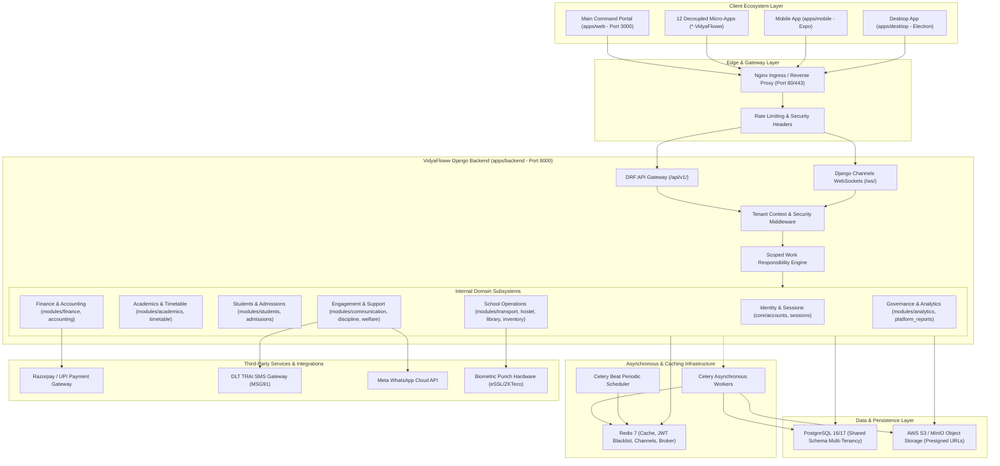
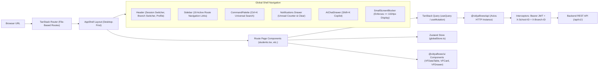
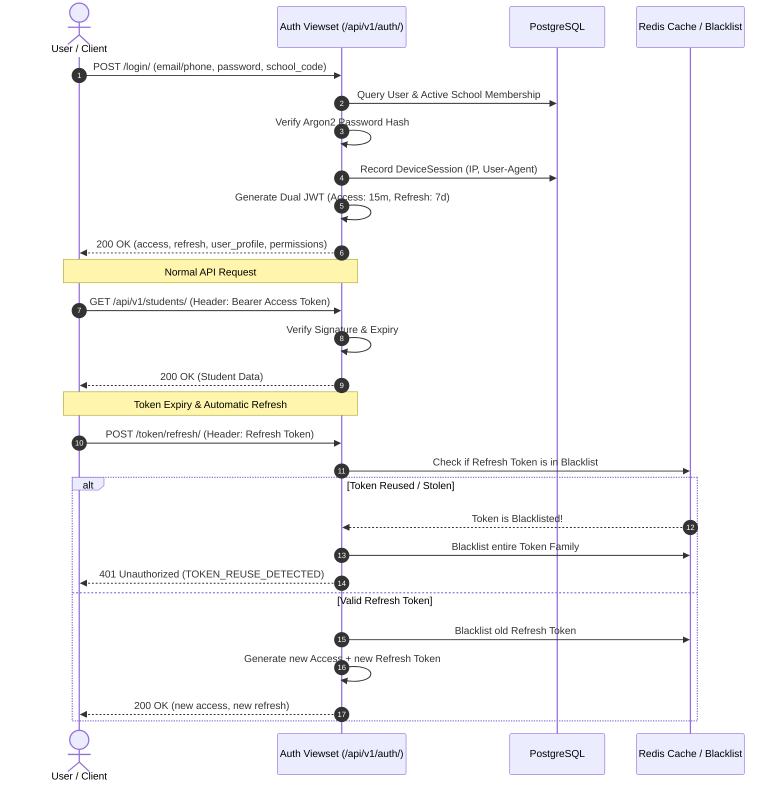
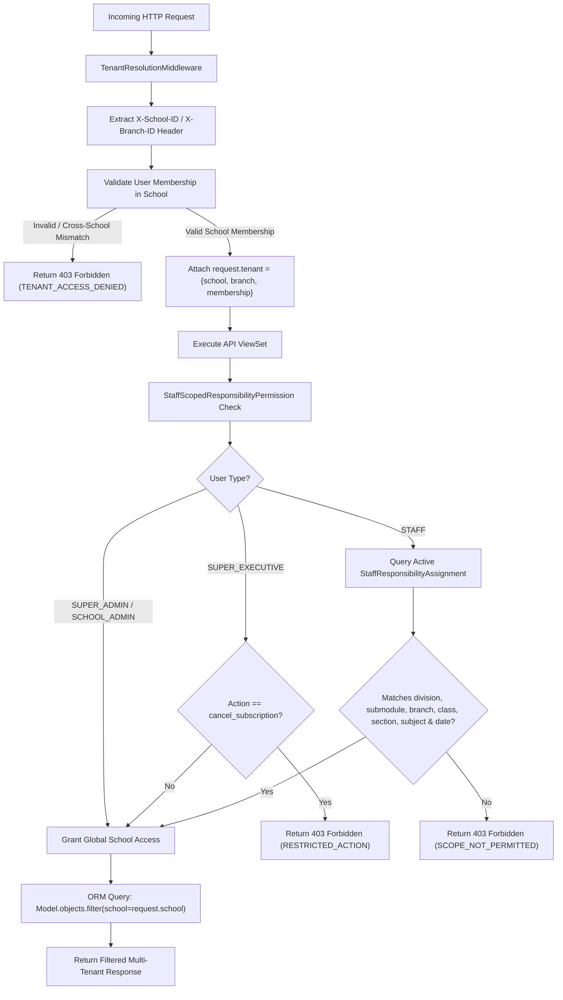
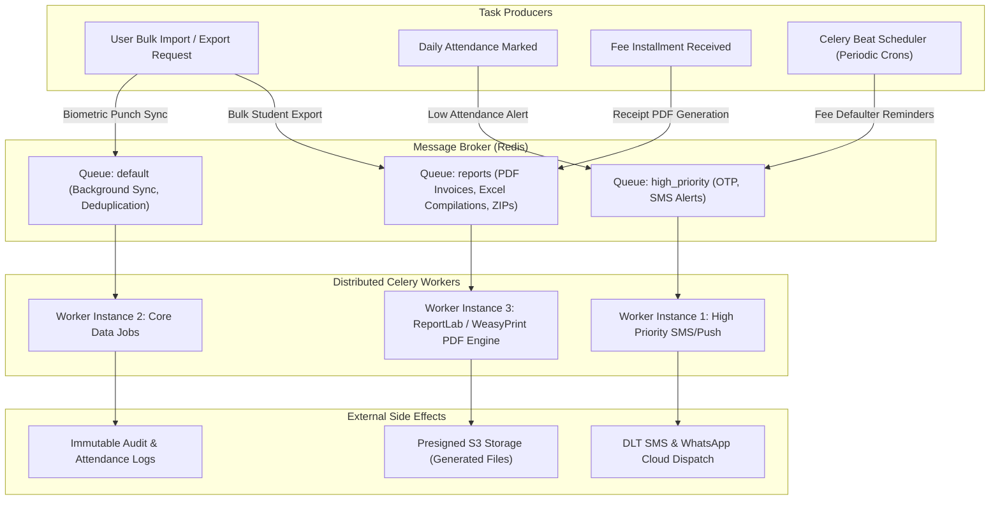

# DOCUMENT 03: COMPLETE SYSTEM ARCHITECTURE

> **Classification**: `EVIDENCE-BASED ARCHITECTURAL SPECIFICATION`  
> **Source Documents**: `docs/architecture/HLD.md`, `ADR-001` through `ADR-008`, `domain-boundaries.md`  

---

## 1. Architectural Style & Monorepo Topology

VidyaFloww adopts a **Hybrid Modular Monolith + Satellite Micro-Frontend Architecture**:

1. **The Core Platform Engine (`VidyaMaxx/apps/backend`)**:
   - A single, highly organized Django 5.2 modular monolith containing 73 AppConfigs and 78 Domain Models.
   - It exposes a unified REST API (`/api/v1/`) and WebSocket gateway (`/ws/`).
   - All modules execute in the same process memory space during development, avoiding distributed network latency, while retaining strict folder and domain boundary encapsulation.
2. **The Command ERP Portal (`VidyaMaxx/apps/web`)**:
   - A desktop-first React 19 single-page application handling daily institutional management across 19 active file-based routes (`src/routes/`).
3. **The 12 Decoupled Satellite Subsystems (`E:\E\VidyaMaxx\*-VidyaFloww`)**:
   - Standalone Vite applications operating on dedicated local development ports (`8010`–`8022`).
   - They handle high-concurrency or specialized tasks (e.g., student fee payments during peak admission season, computer-based exam testing, fleet GPS telematics, live online classrooms).
   - They share the core authentication token (JWT) and consume specialized backend contract adapters (`/api/v1/operations/*`, `/api/v1/finance/*`, `/api/v1/examinations/*`).

---

## 2. Complete Architecture Diagrams

### Diagram 1: High-Level System Architecture

---

### Diagram 2: Web Client Internal Architecture (`apps/web`)

---

### Diagram 3: Modular Monolith Domain Layout (`apps/backend`)

```mermaid
flowchart TD
    subgraph ConfigLayer["Platform Configuration"]
        CONF["apps/backend/config (settings, asgi, wsgi, celery)"]
        COMM["apps/backend/common (models, middleware, permissions, exceptions)"]
    end

    subgraph CoreLayer["Core Identity & Tenancy"]
        ACC["core/accounts (Custom User Model)"]
        AUTH["core/authentication (JWT Rotation & Reuse Detection)"]
        ORG["core/organizations (CustomerTenant, School)"]
        CAMP["core/campuses (Branch / Campus Master)"]
        SESS["core/sessions (DeviceSession Tracking)"]
        PERM["core/permissions (StaffResponsibilityAssignment Engine)"]
    end

    subgraph PlatformLayer["Platform Services"]
        AUDIT["platform_services/audit (Append-Only AuditEvent)"]
        STOR["platform_services/storage (StoredFile & Magic Byte Validator)"]
        NOTIF["platform_services/notifications (InAppNotification)"]
        FORMS["platform_services/forms (SurveyCampaign)"]
        REP["platform_services/reports (Report Generation & Compliance)"]
        SETT["platform_services/settings (SchoolSetting Registry)"]
    end

    subgraph BusinessModules["30 Work Division Business Modules"]
        ACAD["modules/academics"]
        ADM["modules/admissions"]
        STUD["modules/students"]
        HR["modules/hr"]
        TIME["modules/timetable"]
        ATT["modules/attendance"]
        LMS["modules/lms"]
        HW["modules/homework"]
        EXAM["modules/examinations"]
        FIN["modules/finance & accounting"]
        OPS["modules/transport, hostel, library, inventory"]
        ENG["modules/communication, discipline, welfare, medical, events"]
        ANALYTICS["modules/analytics"]
    end

    CONF --> COMM
    COMM --> CoreLayer
    CoreLayer --> PlatformLayer
    PlatformLayer --> BusinessModules
```

---

### Diagram 4: Authentication & Dual JWT Rotation Lifecycle

---

### Diagram 5: Multi-Tenant Request Isolation & Dynamic Scoped RBAC

---

### Diagram 6: Asynchronous Jobs & Celery Worker Topology

