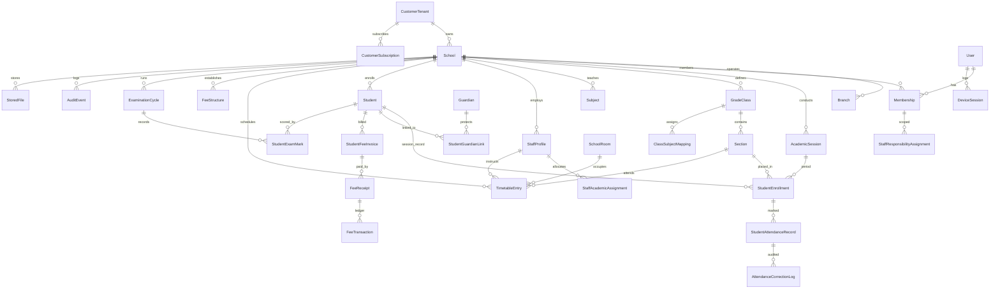

# DOCUMENT 08: COMPLETE DATABASE ARCHITECTURE & SCHEMA SPECIFICATION

> **Classification**: `EVIDENCE-BASED RELATIONAL SCHEMA AUDIT`  
> **Source Directory**: `VidyaMaxx/apps/backend/*/models.py`, `docs/database/erd.md`  
> **Total Verified Models**: 92 Django Models (78 Custom Domain Models across 35 Apps)  

---

## 1. Relational Design Principles

Every domain entity in VidyaFloww conforms to standard architectural invariants defined in `common/models/base.py`:

1. **UUID Primary Keys**: Every table uses a cryptographically secure UUIDv4 (`id = models.UUIDField(primary_key=True, default=uuid.uuid4, editable=False)`) to prevent sequential enumeration attacks.
2. **Tenant Scoping**: All institutional data inherits from `TenantScopedModel`:
   - `school = ForeignKey('organizations.School', on_delete=CASCADE, db_index=True)`
   - `branch = ForeignKey('campuses.Branch', on_delete=CASCADE, null=True, blank=True, db_index=True)`
3. **Auditability**: All models inherit from `AuditModel`:
   - `created_at = DateTimeField(auto_now_add=True, db_index=True)`
   - `updated_at = DateTimeField(auto_now=True)`
   - `created_by = ForeignKey(User, null=True, on_delete=SET_NULL)`
4. **Soft Deletion**: Sensitive operational entities (such as `StaffProfile`, `Student`, `HomeworkAssignment`) inherit `SoftDeleteMixin`, setting `deleted_at = DateTimeField(null=True)` rather than executing SQL `DELETE`.
5. **Strict Immutability**:
   - `AuditEvent`: Append-only system audit log.
   - `FeeReceipt` & `FeeTransaction`: Financial ledger entries. `delete()` raises `403 IMMUTABLE_FINANCIAL_RECORD`.
   - `AttendanceCorrectionLog`: Immutable audit trail of attendance record changes.
   - `ResponsibilityAssignmentHistory`: Immutable audit log of staff permission assignments.

---

## 2. Complete Inventory of the 78 Domain Models by App

| Application | Model Count | Model Names | Key Foreign Keys & Relationships |
|---|---|---|---|
| `accounts` | 1 | `User` | AbstractBaseUser, phone (+91), email, UserType enum |
| `core_users` | 1 | `Membership` | FK(`User`), FK(`School`), UserType, `is_active` |
| `organizations` | 5 | `CustomerTenant`, `SubscriptionPlan`, `CustomerSubscription`, `PlatformInvoice`, `School` | FK(`CustomerTenant`), Tier limits, Billing invoices |
| `campuses` | 1 | `Branch` | FK(`School`), Campus code, principal, address |
| `core_sessions` | 1 | `DeviceSession` | FK(`User`), IP address, User-Agent, last_active |
| `core_permissions` | 3 | `StaffResponsibilityAssignment`, `ResponsibilityAssignmentHistory`, `SecurityPolicy` | FK(`Membership`), Division, Class, Section, Subject |
| `platform_storage` | 1 | `StoredFile` | FK(`School`), S3 key, MIME type, size, presigned flag |
| `platform_audit` | 1 | `AuditEvent` | FK(`User`), FK(`School`), action, model, diff JSONB |
| `platform_settings` | 1 | `SchoolSetting` | FK(`School`), key, value JSONB |
| `platform_notifications` | 1 | `InAppNotification` | FK(`User`), title, message, is_read |
| `platform_forms` | 1 | `SurveyCampaign` | FK(`School`), target audience, questions JSONB |
| `platform_reports` | 2 | `GeneratedReportRecord`, `StatutoryComplianceFiling` | FK(`School`), format, parameters, compliance type |
| `academics` | 9 | `AcademicSession`, `Department`, `House`, `Stream`, `GradeClass`, `Section`, `Subject`, `ClassSubjectMapping`, `AcademicMilestone` | Hierarchical session, class, section, subject mappings |
| `hr` | 3 | `StaffProfile`, `StaffAcademicAssignment`, `StaffDossierFieldConfig` | FK(`User`), FK(`Department`), Employee code, load |
| `students` | 6 | `Student`, `StudentEnrollment`, `Guardian`, `StudentGuardianLink`, `StudentLifecycleEvent`, `StudentDossierFieldConfig` | Admission No, per-session enrollment, guardians |
| `admissions` | 4 | `AdmissionEnquiry`, `AdmissionApplication`, `ApplicantDocument`, `AdmissionInterview` | Enquiries, multi-step application, merit score |
| `timetable` | 4 | `PeriodSlotDefinition`, `SchoolRoom`, `TimetableEntry`, `ProxySubstitution` | Period bell timings, rooms, teacher schedule |
| `attendance` | 3 | `StudentAttendanceRecord`, `AttendanceCorrectionLog`, `LeaveApplication` | Daily roll-call, biometric punch, audit logs |
| `lms` | 4 | `LessonPlan`, `TeachingDiaryEntry`, `LearningResource`, `OnlineClassSession` | Curriculum lesson objectives, WebRTC rooms |
| `homework` | 2 | `HomeworkAssignment`, `HomeworkSubmission` | Assignment instructions, student file uploads |
| `examinations` | 2 | `ExaminationCycle`, `StudentExamMark` | Exam datesheet, marks ledger, lock status |
| `accounting` | 1 | `ChartOfAccount` | General ledger account codes & types |
| `finance` | 5 | `FeeStructure`, `ScholarshipGrant`, `StudentFeeInvoice`, `FeeReceipt`, `FeeTransaction` | Fee installments, receipts, reversal ledgers |
| `certificates` | 2 | `CertificateTemplate`, `IssuedCertificate` | Template layout JSON, issued certificate hashes |
| `documents` | 1 | `ComplianceDocumentRecord` | Institutional statutory proof files |
| `library` | 1 | `LibraryBookSummary` | Book catalog, ISBN, accession counts |
| `transport` | 1 | `TransportRouteRecord` | Bus routes, vehicle numbers, student stops |
| `hostel` | 1 | `HostelAllocationRecord` | Hostel blocks, rooms, bed numbers |
| `inventory` | 2 | `InventoryStockItem`, `FixedAssetRecord` | Stock consumables, asset maintenance logs |
| `medical` | 1 | `InfirmaryVisitLog` | Student ailments, prescriptions, triage notes |
| `welfare` | 1 | `CounsellingRecord` | Confidential session notes, therapist logs |
| `communication` | 1 | `CircularBroadcast` | Multi-channel broadcast messages |
| `events` | 3 | `SchoolCalendarEvent`, `StudentActivityRecord`, `FrontOfficeVisitorPass` | Events calendar, House points, Visitor passes |
| `discipline` | 1 | `GrievanceTicket` | Helpdesk complaints, SLA deadlines, resolutions |
| `analytics` | 1 | `SubsystemIntegrationStatus` | Decoupled micro-app synchronization health |

---

## 3. High-Level Entity Relationship Diagram (ERD)



---

## 4. Multi-Session Student History Invariant

A common architectural failure in legacy school ERPs is overwriting student `class` and `section` fields upon annual promotion, destroying their historical record.

VidyaFloww solves this through the **`StudentEnrollment`** model:
- The `Student` model stores invariant demographic identity (Name, Aadhaar, DOB, Blood Group, Admission Number).
- Placement data is stored per session in `StudentEnrollment`:
  ```python
  class StudentEnrollment(TenantScopedModel):
      student = models.ForeignKey(Student, on_delete=models.CASCADE, related_name='enrollments')
      academic_session = models.ForeignKey(AcademicSession, on_delete=models.CASCADE)
      grade_class = models.ForeignKey(GradeClass, on_delete=models.CASCADE)
      section = models.ForeignKey(Section, on_delete=models.CASCADE)
      roll_number = models.CharField(max_length=50, blank=True)
      status = models.CharField(max_length=20, default='ACTIVE')
      
      class Meta:
          unique_together = ('student', 'academic_session')
  ```
- Annual promotion creates a new `StudentEnrollment` for the new session, guaranteeing that historical marks, attendance, and fee invoices remain permanently linked to the exact grade and section the student attended that year.
