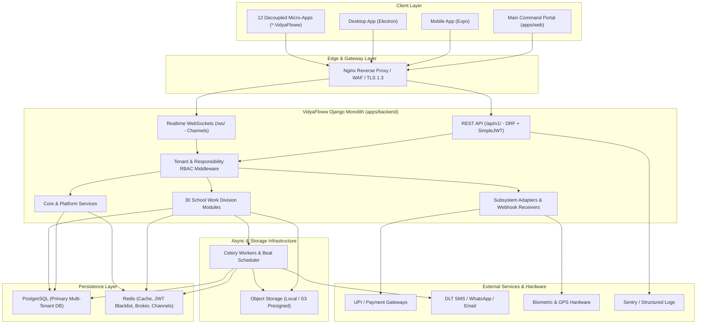
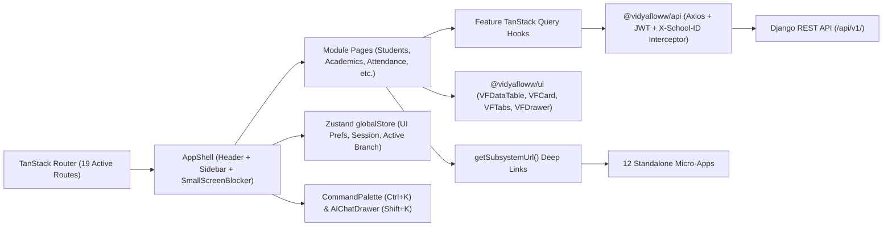
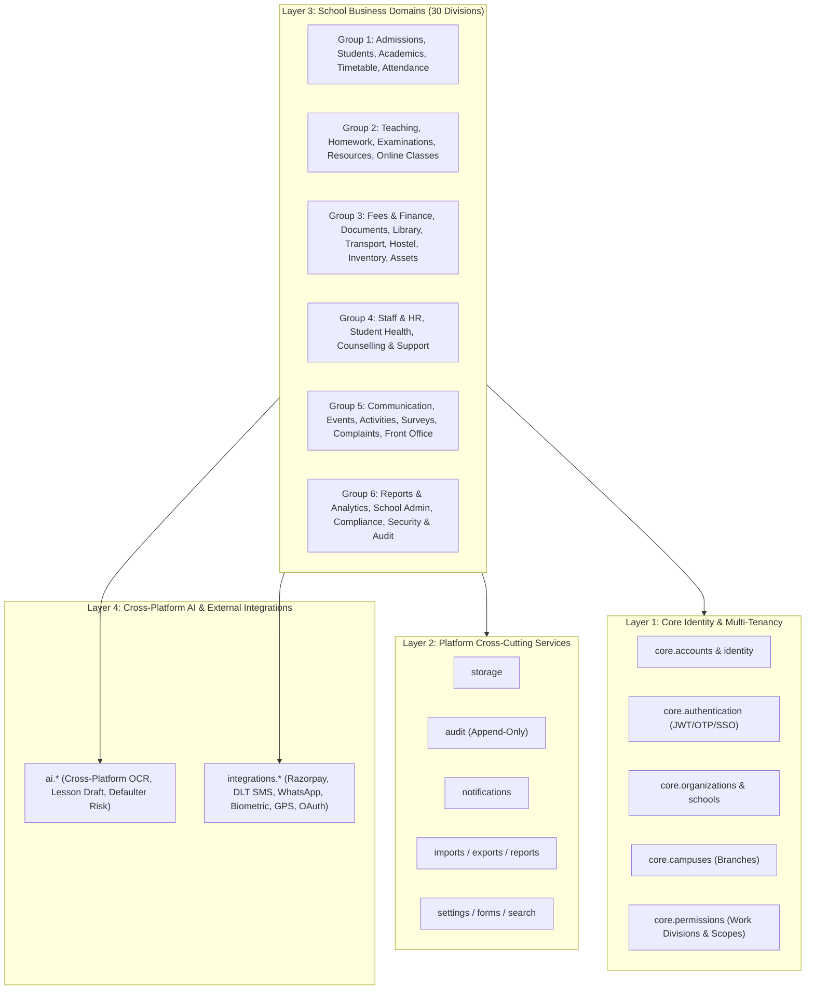
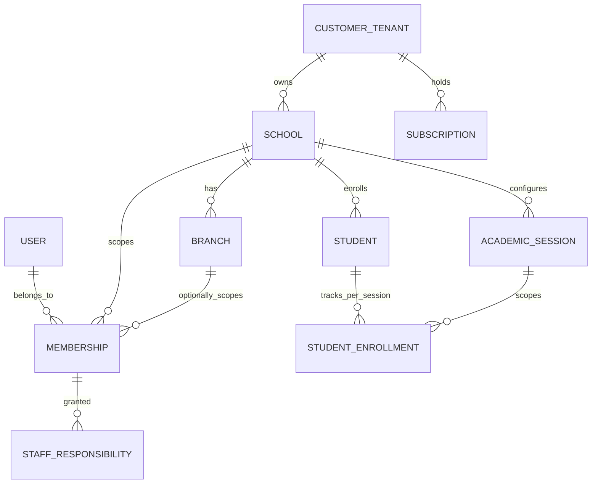
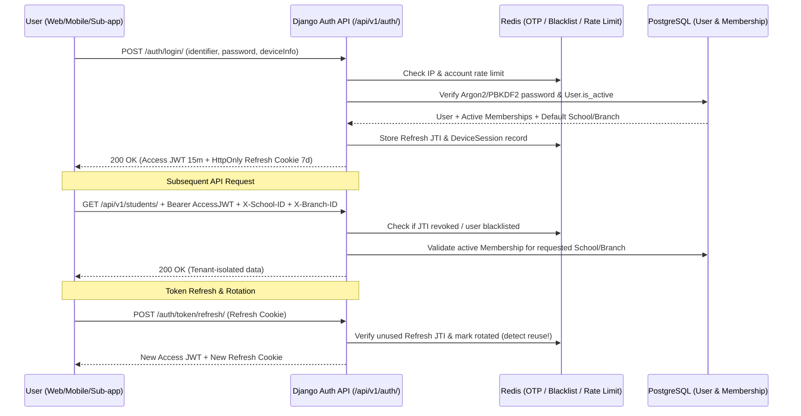
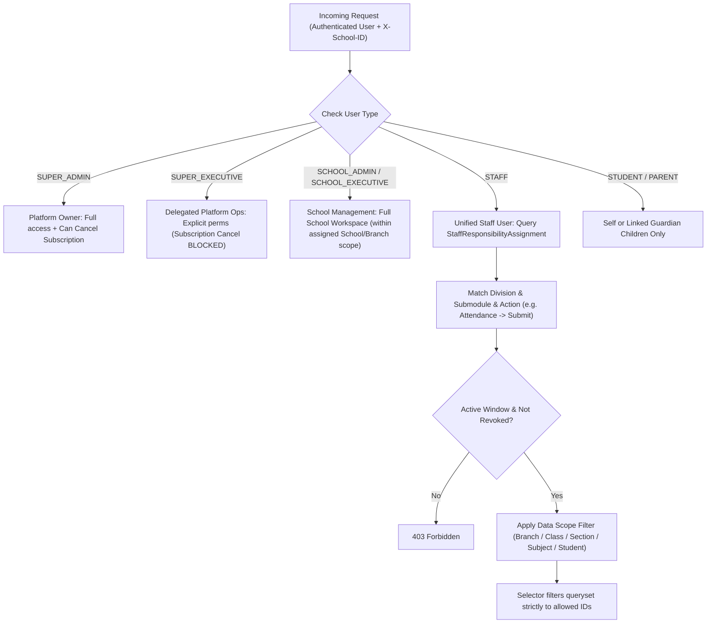
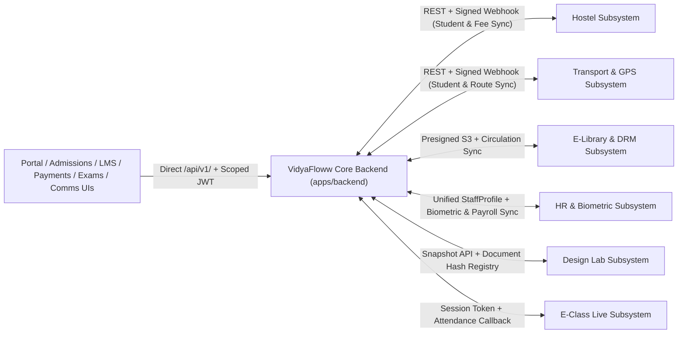
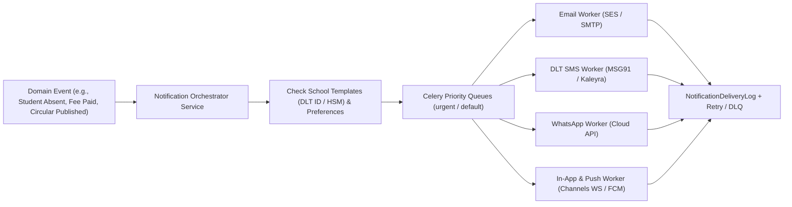
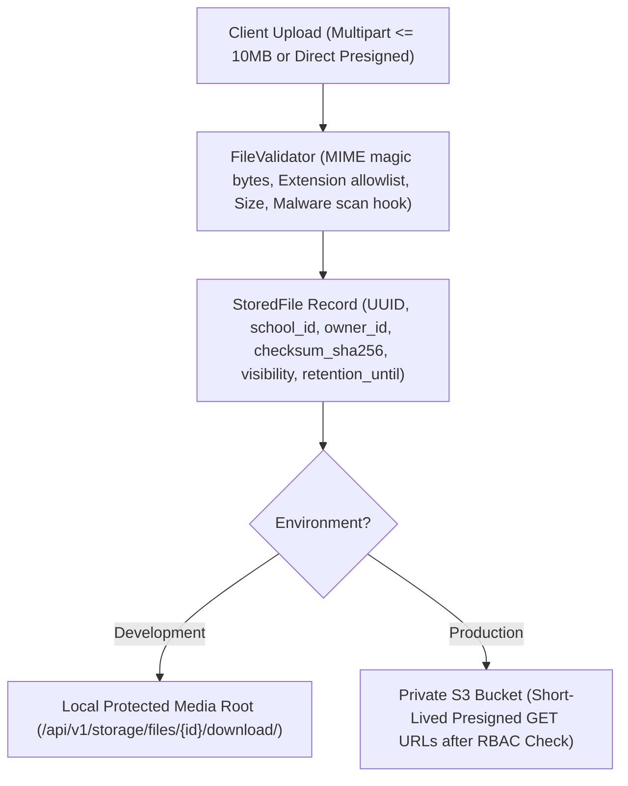
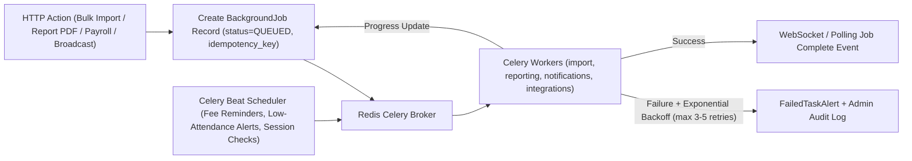

# VidyaFloww — High-Level Design (HLD)

> **Version**: 1.0.0 (Phase 0 Architecture Baseline)  
> **Scope**: Multi-Tenant School Management SaaS Platform (`VidyaFloww`)

---

## 1. System Overview

VidyaFloww is a multi-tenant, India-first School Management SaaS platform unifying institutional administration, academic operations, finance, compliance, and stakeholder portals.

### Ecosystem Components
- **Clients**:
  - **Main Command Portal (`apps/web`)**: React 19 + TypeScript + Vite + TanStack Router/Query command ERP (port `3000`).
  - **Desktop (`apps/desktop`) & Mobile (`apps/mobile`)**: Electron & React Native/Expo shells consuming `/api/v1/`.
  - **12 Decoupled Standalone Micro-Frontends (`*-VidyaFloww`)**: Portal (`8017`), Admissions (`8018`), LMS (`8019`), Payments (`8020`), Examinations (`8021`), Communication (`8022`), Design Lab (`8010`), Hostel (`8011`), Transport (`8012`), HR/Biometrics (`8013`), E-Library (`8014`), E-Class (`8016`).
- **Modular Django Monolith (`apps/backend`)**:
  - Django 5.2 + DRF 3.18 REST API (`/api/v1/`), Django Channels 4.3 WebSockets (`/ws/`), `drf-spectacular` OpenAPI 3.1.
- **Data & Async Infrastructure**:
  - **PostgreSQL 16/17**: Primary relational database with shared-schema tenant/school isolation (`school_id` + `tenant_id` indexing + PostgreSQL RLS defense-in-depth).
  - **Redis 7**: Cache backend, SimpleJWT revocation blacklist, Channels layer, Celery message broker & beat schedule.
  - **Celery 5.6 + Celery Beat**: Asynchronous imports/exports, PDF/Excel reports, SMS/WhatsApp/Email dispatch, scheduled reminders, webhook retries.
  - **Object Storage**: Local filesystem in development; AWS S3 / S3-compatible presigned URLs in production.
- **External Integrations**: Razorpay/Cashfree/PayU (UPI/Cards), DLT SMS (MSG91/Kaleyra), Meta WhatsApp Cloud API, AWS SES/SMTP, Biometric hardware (eSSL/ZKTeco), GPS fleet feeds, Google/Microsoft OAuth SSO, Sentry monitoring.

---

## 2. Architecture Diagrams

### 2.1 Overall System Architecture

### 2.2 Main Portal Architecture (`apps/web`)

### 2.3 Backend Domain Architecture

### 2.4 Database Architecture (Shared Schema + Tenant Hierarchy)

### 2.5 Authentication Architecture

### 2.6 Authorization & Scoped Responsibility Architecture

### 2.7 External Subsystem & Micro-App Integrations

### 2.8 Notification Architecture

### 2.9 File & Document Management Architecture

### 2.10 Background Task & Async Processing Architecture

---

## 3. Domain Boundaries & Data Ownership

- **Single Source of Truth**:
  - **CustomerTenant, School, Branch, User, Membership, WorkResponsibility** owned by `core.*`.
  - **Student Master, Guardians, Academic Enrollments** owned by `modules.students` (Admission applicants only materialize as Students upon atomic approval/enrollment in `modules.admissions`).
  - **Staff Master** owned by unified `StaffProfile` (`modules.hr`), linking to academic subject/class assignments without creating separate Teacher/Librarian/Accountant auth accounts.
  - **Financial Ledgers & Receipts**: Append-only immutable transaction rows owned by `modules.finance` + `modules.accounting`; corrections use reversal/adjustment entries, never row deletion.
- **External Specialized Subsystems**: Transport telematics/vehicles/routes, Hostel bed/mess/outpass operations, E-Library DRM streaming, Design Lab vector rendering, E-Class WebRTC rooms, and Biometric clock hardware own their operational telemetry while exchanging canonical UUIDs and webhooks with `apps/backend`.

---

## 4. Multi-Tenancy Architecture

- **Model**: Shared PostgreSQL database with hierarchical ownership: `CustomerTenant` -> `School` -> `Branch` (optional branch scope).
- **Enforcement**:
  1. `TenantContextMiddleware` resolves active `school_id` and `branch_id` from verified JWT claims or `X-School-ID` / `X-Branch-ID` headers **only after validating** an active `Membership` row for `(request.user, school)`.
  2. Context is stored in `contextvars` (async/Celery safe) and passed explicitly to Services & Selectors.
  3. All Selectors require explicit `school_id` (and `branch_id` if branch-scoped); unauthenticated or unverified cross-school object lookups return `404`/`403`.
  4. **Defense-in-Depth**: PostgreSQL Row Level Security (RLS) policies on high-sensitivity tables (`students_student`, `finance_transaction`, `medical_healthrecord`, `welfare_counsellingrecord`) bound to session variable `app.current_school_id`.
- **Multi-School Access**: A `User` has M:N access across multiple `School`s via `Membership`, with independent `user_type` and `StaffResponsibilityAssignment`s per school.

---

## 5. Architecture Decision Records (ADRs)

Full ADR documents live in `docs/architecture/decisions/`:
- `ADR-001-modular-django-monolith.md`
- `ADR-002-postgresql-shared-schema-multitenancy.md`
- `ADR-003-jwt-rotation-otp-authentication.md`
- `ADR-004-scoped-work-responsibility-rbac.md`
- `ADR-005-external-subsystem-integration-contracts.md`
- `ADR-006-file-storage-and-presigned-access.md`
- `ADR-007-celery-async-jobs-and-idempotency.md`
- `ADR-008-api-versioning-and-error-envelope.md`
