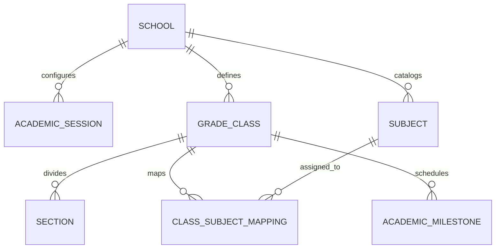

# LLD — Academics (`modules.academics`)

> **Work Division #**: `3` | **Group**: `GROUP 1 — STUDENTS`  
> **UI Coverage**: `apps/web/src/routes/academics.tsx` (`/academics`), `Header.tsx` (Academic Session Switcher)

---

## 1. Module Purpose
Owns the institutional academic hierarchy: Academic Sessions, Grade Classes, Sections, Streams, Houses, Academic Departments, Subjects, Class-Subject Curriculum Mappings (weekly periods, theory/internal marks split, prescribed textbook reference), and Term Academic Milestones.

## 2. Sub-Module Structure
- **Sessions & Calendar**: `AcademicSession`, `AcademicCalendarEvent`.
- **Class & Section Matrix**: `GradeClass` (e.g., `Class 10`, stage `Secondary`), `Section` (`A`, `B`, room, capacity, mentor), `Stream`, `House`.
- **Subjects & Curriculum**: `Department`, `Subject`, `ClassSubjectMapping` (with prescribed book metadata + deep link to E-Library).
- **Milestones**: `AcademicMilestone` (`Mid-Term Exam`, `Periodic Test`, `Pre-Board Exam`, `Final CBSE Board`, `Internal Assessment & Practical`).

## 3. Business Workflows

## 4. Database Entities & Constraints
- **`AcademicSession(TenantScopedModel)`**: `name` (`"2026-2027"`), `code`, `start_date`, `end_date`, `is_current`. *(Check: `end_date > start_date`; Unique: `(school, code)`)*
- **`Department(TenantScopedModel)`**: `code`, `name`, `head_staff_name`. *(Unique: `(school, code)`)*
- **`House(TenantScopedModel)`**: `code`, `name`, `color_hex`, `motto`. *(Unique: `(school, code)`)*
- **`Stream(TenantScopedModel)`**: `code`, `name` (`Science`, `Commerce`, `Humanities`).
- **`GradeClass(TenantScopedModel)`**: `code` (`"CLS-10"`), `name` (`"Class 10"`), `hindi_name` (`"कक्षा 10"`), `numeric_grade` (`10`), `stage` (`Primary|Middle|Secondary|Senior Secondary`), `class_mentor_name`, `room_number`, `display_order`. *(Unique: `(school, code)`)*
- **`Section(TenantScopedModel)`**: `grade_class (FK)`, `name` (`"A"`), `code` (`"10-A"`), `capacity` (`40`), `room_number`, `class_teacher_id (UUID, nullable)`. *(Unique: `(grade_class, name)`)*
- **`Subject(TenantScopedModel)`**: `code` (`"SCI-101"`), `name`, `department (FK, nullable)`, `curriculum_tier` (`Core Compulsory|Core Science|Language & Comms|Commerce Core|Skill & IT|Humanities Core|Elective`), `is_elective`. *(Unique: `(school, code)`)*
- **`ClassSubjectMapping(TenantScopedModel)`**: `grade_class (FK)`, `subject (FK)`, `weekly_periods`, `theory_marks`, `internal_marks`, `teacher_in_charge`, `syllabus_chapters`, `prescribed_book_json` (`title`, `publisher`, `type`, `edition`, `code`), `status` (`Active|Elective`). *(Unique: `(grade_class, subject)`)*
- **`AcademicMilestone(TenantScopedModel)`**: `grade_class (FK)`, `academic_session (FK, nullable)`, `title`, `term`, `start_date`, `end_date`, `target_syllabus_coverage` (`0..100`), `assessment_type`, `status` (`In Progress|Upcoming|Scheduled|Completed`), `notes`.

## 5. API Endpoints (`/api/v1/academics/`)
- `GET/POST /api/v1/academics/sessions/`, `PATCH /api/v1/academics/sessions/{id}/`
- `GET/POST /api/v1/academics/classes/`, `GET/PATCH /api/v1/academics/classes/{id}/`
- `GET/POST /api/v1/academics/sections/`
- `GET/POST /api/v1/academics/subjects/`
- `GET/POST /api/v1/academics/class-subjects/`, `PATCH/DELETE /api/v1/academics/class-subjects/{id}/`
- `GET/POST /api/v1/academics/milestones/`, `PATCH/DELETE /api/v1/academics/milestones/{id}/`
- `GET/POST /api/v1/academics/houses/`, `GET/POST /api/v1/academics/departments/`

## 6. Permissions, Validations & Audit
- Division: `WorkDivision.ACADEMICS` (`view` for all school members; `create`/`edit`/`delete` requires `SCHOOL_ADMIN`, `SCHOOL_EXECUTIVE`, or `STAFF` with `academics` responsibility).
- Activating an `AcademicSession` (`is_current=True`) atomically unsets `is_current` on other sessions in the same school and updates `School.active_academic_session_label`.
- All write actions log an `AuditEvent(category="Settings")`.
