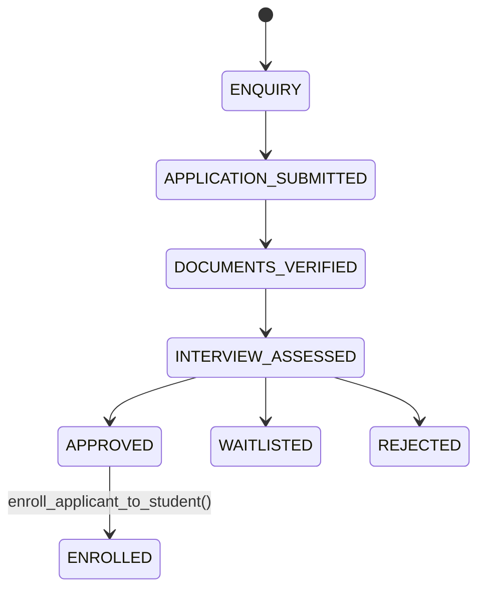

# LLD — Admissions (`modules.admissions`)

> **Work Division #**: `1` | **Group**: `GROUP 1 — STUDENTS`  
> **UI Coverage**: `Admissions-VidyaFloww` (`AdmissionsModule.tsx`), Dashboard New Admissions KPI

---

## 1. Module Purpose
Manages applicant intake from initial parent enquiry/lead through application form submission, document upload & verification, interview/merit assessment, selection approval, and **atomic conversion into an enrolled `Student` record**.

## 2. Business Workflow & State Machine

**Invariant**: An applicant **never** becomes an active `Student` in `modules.students` until an authorized officer executes the `POST /api/v1/admissions/applications/{id}/enroll/` workflow on an `APPROVED` application.

## 3. Database Entities
- **`AdmissionEnquiry(TenantScopedModel)`**: `enquiry_number`, `candidate_name`, `applied_grade_label`, `guardian_name`, `phone`, `email`, `source` (`Walk-In|Website|Referral|Campaign`), `status` (`OPEN|FOLLOW_UP|CONVERTED|CLOSED`), `follow_up_notes`, `next_follow_up_date`.
- **`AdmissionApplication(TenantScopedModel)`**:
  - `application_number` (`"APP-2026-101"`) — *Unique `(school, application_number)`*
  - `academic_session (FK -> AcademicSession, nullable)`, `applied_class (FK -> GradeClass, nullable)`, `applied_grade_label`
  - `candidate_name`, `date_of_birth`, `gender`, `blood_group`, `category_quota`, `previous_school_name`, `previous_score_pct`
  - `primary_guardian_name`, `primary_guardian_relation`, `guardian_phone`, `guardian_email`, `guardian_occupation`, `address`, `city`
  - `merit_score` (`Decimal(5,2)`), `documents_verified` (`Boolean`), `stage` (`PENDING|UNDER_REVIEW|INTERVIEW_SCHEDULED|APPROVED|WAITLISTED|REJECTED|ENROLLED`)
  - `enrolled_student (OneToOne -> students.Student, nullable)`, `decision_remarks`, `decided_by_id`, `decided_at`.
- **`ApplicantDocument(TenantScopedModel)`**:
  - `application (FK)`, `document_type` (`Birth Certificate|Transfer Certificate|Aadhaar|Marksheet|Photo`), `stored_file (FK -> StoredFile, nullable)`, `verification_status` (`PENDING|VERIFIED|REJECTED`), `verified_by_id`, `remarks`.
- **`AdmissionInterview(TenantScopedModel)`**:
  - `application (FK)`, `interviewer_name`, `scheduled_date`, `score`, `recommendation` (`Strongly Recommend|Recommend|Hold|Reject`), `remarks`.

## 4. API Endpoints (`/api/v1/admissions/`)
- `GET/POST /api/v1/admissions/enquiries/`, `PATCH /api/v1/admissions/enquiries/{id}/`
- `GET/POST /api/v1/admissions/applications/`, `GET/PATCH /api/v1/admissions/applications/{id}/`
- `POST /api/v1/admissions/applications/{id}/approve/`
- `POST /api/v1/admissions/applications/{id}/enroll/` (Atomically creates `Student` + `Guardian` + `StudentGuardianLink` + `StudentEnrollment` + `StudentLifecycleEvent` + `AuditEvent`)
