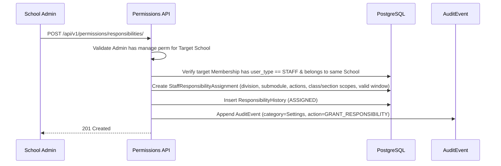

# LLD — Identity, Multi-Tenancy, Subscriptions & Responsibility RBAC (Phase 1 Foundation)

> **Phase**: 1 (Foundation) | **Apps**: `core.accounts`, `core.authentication`, `core.organizations`, `core.campuses`, `core.permissions`, `core.sessions`, `platform_services.audit`  
> **UI Coverage**: `/login`, `/settings`, `/security`, `/audit`, `/license`, `Header.tsx`

---

## 1. Module Purpose
Establishes the canonical user identity, multi-tenant customer -> school -> branch hierarchy, SaaS subscription licensing, JWT+OTP authentication, device session tracking, and scoped work-responsibility authorization across all 30 school divisions.

## 2. Sub-Module Structure
- **Authentication (`core.authentication`)**: Login, Register (4-step + OTP), Password Reset (OTP + action token), Username Recovery (Phone + DOB + OTP), Google SSO, Token Refresh/Rotation, Logout/Revoke.
- **Tenancy & Institutions (`core.organizations`, `core.campuses`)**: `CustomerTenant`, `SubscriptionPlan`, `CustomerSubscription`, `PlatformInvoice`, `School`, `Branch`.
- **Memberships & Responsibilities (`core.accounts`, `core.permissions`)**: `User`, `Membership`, `WorkDivision`, `StaffResponsibilityAssignment`, `ResponsibilityHistory`, `SecurityPolicy`.
- **Sessions & Audit (`core.sessions`, `platform_services.audit`)**: `DeviceSession`, `AuditEvent`.

## 3. Business Workflows

## 4. Database Entities
- **`CustomerTenant`**: `id (UUID)`, `name`, `slug (unique)`, `owner_user (FK -> User)`, `contact_email`, `billing_address`, `gstin (nullable)`, `is_active`.
- **`CustomerSubscription`**: `id`, `tenant (FK)`, `plan (FK -> SubscriptionPlan)`, `license_key (encrypted/masked hash + prefix)`, `status (ACTIVE|TRIAL|PAST_DUE|CANCELLED)`, `current_period_start`, `current_period_end`, `cancelled_at`, `cancelled_by`.
- **`School`**: `id`, `tenant (FK)`, `name`, `short_code`, `tagline`, `city`, `state`, `board_affiliation (CBSE|ICSE|STATE|IB)`, `affiliation_number`, `logo (FK -> StoredFile)`, `timezone (default Asia/Kolkata)`, `currency (default INR)`, `is_active`.
- **`Branch`**: `id`, `school (FK)`, `code`, `name`, `city`, `address`, `is_primary`, `principal_name`, `cover_url`, `status (ACTIVE|INACTIVE)`. *(Unique `(school, code)`)*
- **`User` (`AUTH_USER_MODEL`)**: `id (UUID)`, `email (unique, nullable)`, `phone (unique, nullable)`, `full_name`, `date_of_birth (nullable)`, `is_verified`, `is_active`, `password`, `last_login`. *(Check constraint: `email IS NOT NULL OR phone IS NOT NULL`)*
- **`Membership`**: `id`, `tenant (FK)`, `school (FK, nullable for platform level)`, `user (FK)`, `user_type (SUPER_ADMIN|SUPER_EXECUTIVE|SCHOOL_ADMIN|SCHOOL_EXECUTIVE|STAFF|STUDENT|PARENT)`, `default_branch (FK, nullable)`, `is_active`. *(Unique `(user, school, user_type)`)*
- **`StaffResponsibilityAssignment`**: `id`, `school (FK)`, `membership (FK)`, `work_division (CharField 30 choices)`, `submodule_code`, `actions (ArrayField/M2M: view,create,edit,delete,approve,export,manage)`, `branch_ids`, `grade_class_ids`, `section_ids`, `subject_ids`, `student_ids`, `valid_from`, `valid_until`, `revoked_at`, `revoked_by`, `granted_by`.
- **`SecurityPolicy`**: `id`, `school (OneToOne)`, `two_factor_enforced`, `session_timeout_minutes`, `ip_whitelist_cidrs (JSONField)`.
- **`DeviceSession`**: `id`, `user (FK)`, `refresh_jti`, `device_id`, `platform`, `ip_address`, `user_agent`, `last_active_at`, `revoked_at`.
- **`AuditEvent`**: `id`, `tenant_id`, `school_id`, `actor_user_id`, `actor_role_label`, `category`, `action`, `target_type`, `target_id`, `metadata_json`, `ip_address`, `status (SUCCESS|WARNING|BLOCKED)`, `created_at`.

## 5. Model Relationships & Constraints
- `CustomerTenant` 1:N `School` 1:N `Branch`.
- `User` M:N `School` via `Membership`.
- `StaffResponsibilityAssignment` check constraint: `valid_until IS NULL OR valid_until > valid_from`.
- At least one active `Primary Branch` rule validated in `Branch` service.
- `CustomerSubscription` cancellation service explicitly raises `PermissionDenied` (`403`) if `membership.user_type == SUPER_EXECUTIVE` (only `SUPER_ADMIN` can cancel).

## 6. API Endpoints (`/api/v1/`)
- `POST /api/v1/auth/login/`, `/register/`, `/otp/verify/`, `/password/reset/`, `/username/lookup/`, `/google/`, `/token/refresh/`, `/logout/`, `GET /auth/me/`
- `GET/PATCH /api/v1/schools/current/`, `GET/POST/PATCH /api/v1/schools/branches/`
- `GET/POST/PATCH/DELETE /api/v1/permissions/responsibilities/`
- `GET/PATCH /api/v1/security/policies/`
- `GET /api/v1/audit/events/`, `GET/POST /api/v1/audit/sessions/`
- `GET /api/v1/platform/subscription/`, `POST /api/v1/platform/subscription/cancel/` (Super Admin only!)
- `GET /api/v1/health/` (Public DB + Redis status)

## 7. Business Validations & Error Handling
- OTP brute-force protection: Lock OTP after 5 wrong attempts; rate-limit OTP requests to 3 per 10 mins per phone/email.
- Cross-school header spoofing: If `X-School-ID` does not match an active `Membership` for `request.user`, fail with `403 TENANT_ACCESS_DENIED` and log an `AuditEvent(status=BLOCKED)`.
- `StaffResponsibilityAssignment` cannot be attached to `STUDENT` or `PARENT` memberships.

## 8. Test Scenarios
1. Multi-school isolation: User with `SCHOOL_ADMIN` in School A receives `403`/`404` when sending `X-School-ID: School B`.
2. Super Executive guard: `SUPER_EXECUTIVE` can update payment card / view invoices (`200`), receives `403` on `POST /platform/subscription/cancel/`, while `SUPER_ADMIN` succeeds (`200`).
3. Scoped Staff check: Teacher assigned `attendance:submit` for `Class 6-A` succeeds (`200`) for `6-A` and fails (`403`) for `6-B` or `fees:create`.
4. Temporary assignment expiry: Assignment with `valid_until` in the past automatically denies access.
5. Refresh token rotation reuse detection: Replaying a rotated refresh cookie immediately revokes the `DeviceSession` and rejects (`401`).
