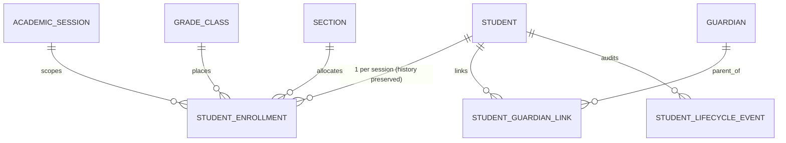

# LLD — Students 360° Directory (`modules.students`)

> **Work Division #**: `2` | **Group**: `GROUP 1 — STUDENTS`  
> **UI Coverage**: `apps/web/src/routes/students.tsx` (`/students`)

---

## 1. Module Purpose
Manages the central Student 360° master directory, parent/guardian linkages, dynamic dossier custom fields, and **immutable per-session academic enrollment history** (`StudentEnrollment`) across promotions, section transfers, withdrawals, and re-admissions.

## 2. Database Entities & Historical Preservation

- **`Student(TenantScopedModel, SoftDeleteMixin)`**:
  - `admission_number` (`"ADM-2026-001"`) — *Unique `(school, admission_number)`*
  - `full_name`, `date_of_birth`, `gender` (`male|female|other`), `blood_group`, `category_quota` (`General|OBC|SC|ST|EWS|RTE`), `aadhaar_masked`, `avatar_url`, `status` (`active|inactive|graduated|suspended|withdrawn|transferred`), `joined_date`, `address`, `city`, `medical_notes`, `transport_route_label`, `bus_stop_label`, `fee_status` (`Paid|Pending|Overdue|Partial|Waived`), `fee_dues_inr` (`Decimal(12,2)`), `attendance_pct` (`Decimal(5,2)`), `gpa` (`Decimal(4,2)`), `custom_fields_json`.
  - Denormalized active pointers for fast directory queries: `current_grade_class (FK, nullable)`, `current_section (FK, nullable)`, `current_roll_number`, `house_name`, `class_teacher_name`.
- **`StudentEnrollment(TenantScopedModel)`**:
  - `student (FK)`, `academic_session (FK)`, `grade_class (FK)`, `section (FK, nullable)`, `roll_number`, `house (FK, nullable)`, `enrollment_status` (`ACTIVE|PROMOTED|DETAINED|TRANSFERRED|WITHDRAWN|GRADUATED`), `promoted_from (FK -> self, nullable)`, `remarks`.
  - *UniqueConstraint: `(student, academic_session)`* — **Guarantees promotion creates a new session row and never overwrites historical enrollment!**
- **`Guardian(TenantScopedModel)`**:
  - `user (FK -> accounts.User, nullable)`, `full_name`, `relationship` (`father|mother|guardian|other`), `phone`, `email`, `occupation`, `annual_income_inr`, `is_primary_emergency`.
- **`StudentGuardianLink(TenantScopedModel)`**:
  - `student (FK)`, `guardian (FK)`, `relationship`, `is_primary_contact`, `can_pickup`.
- **`StudentLifecycleEvent(TenantScopedModel)`**:
  - `student (FK)`, `event_type` (`ENROLLED|PROMOTED|TRANSFERRED|WITHDRAWN|READMITTED|STATUS_CHANGED`), `from_session_label`, `to_session_label`, `from_class_label`, `to_class_label`, `reason`, `performed_by_id`.
- **`StudentDossierFieldConfig(TenantScopedModel)`**:
  - `field_key`, `label`, `category` (`personal|family|operations`), `field_type`, `is_visible`, `is_custom`.

## 3. API Endpoints (`/api/v1/students/`)
- `GET/POST /api/v1/students/` (filters: `status`, `grade_class_id`, `section_id`, `fee_status`, `search`)
- `GET/PATCH/DELETE /api/v1/students/{id}/`
- `GET /api/v1/students/{id}/enrollments/` (full multi-session academic history)
- `POST /api/v1/students/{id}/promote/` (transactional promotion to target `academic_session` + `grade_class` + `section`)
- `POST /api/v1/students/{id}/transfer/` (intra-school section/branch transfer or TC withdrawal)
- `POST /api/v1/students/{id}/withdraw/` & `POST /api/v1/students/{id}/readmit/`
- `POST /api/v1/students/bulk-import/`
- `GET/POST /api/v1/students/dossier-fields/`

## 4. Business Validations & Permissions
- Division: `WorkDivision.STUDENTS`.
- Promoting a student requires `target_session != current_session`, marks previous `StudentEnrollment` as `PROMOTED`, creates a new `StudentEnrollment(status=ACTIVE)`, updates `Student.current_grade_class` & `current_section`, and appends `StudentLifecycleEvent` + `AuditEvent`.
